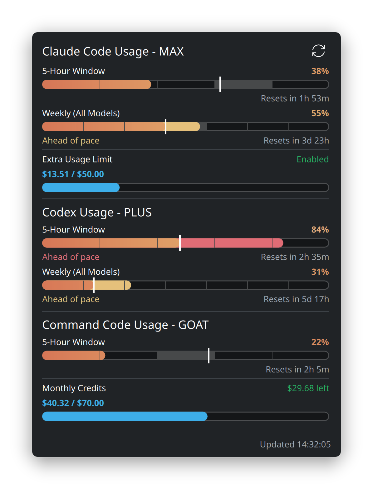

# Usage Limits (`plasma-applet-usagelimits`)

[](https://kde.org/plasma-desktop/)
[](LICENSE)
[](#supported-providers)

A KDE Plasma 6 panel & desktop widget that tracks your live subscription rate limits and credit pools across **6 AI coding providers** in one place:

- **Claude Code** (Pro / Max / Team — 5-hour window, weekly all-models, scoped model weeklies, Extra Usage, and limit resets)
- **OpenAI Codex** (ChatGPT Plus / Pro / Team — 5-hour and 7-day windows with automatic token refresh)
- **OpenCode Go** (5-hour rolling, weekly, and monthly windows)
- **Z.ai** (GLM Coding Plan — 5-hour, weekly/monthly, and MCP tool quotas)
- **Google Antigravity** (Claude/GPT and Gemini 5-hour & weekly quota buckets)
- **Command Code** (Go / Pro / GOAT / Max / Ultra — 5-hour & weekly rate limits + monthly credit pool)


## Features



- **Six AI providers in one applet** — reads credentials directly from each CLI's existing sign-in file (`~/.claude`, `~/.codex`, `~/.local/share/opencode`, `~/.commandcode`, T3 / `agy` OAuth). No extra daemon or third-party service required.
- **Segmented Pace Bars & "Ahead of pace"** — inspired by [plasma-applet-claudemeter](https://github.com/p3kj/plasma-applet-claudemeter):
  - 5-hour windows are split into **5 hourly segments**; weekly windows into **7 daily segments**; monthly windows into **6 segments**.
  - A vertical caret marks the exact current position in the window, with the active segment softly highlighted.
  - Usage that runs past the caret steps up in color and displays **Ahead of pace** beneath the bar.
- **4-Stop Smooth Color Gradients** — customize **Low (0%)**, **Medium (~40%)**, **Warning**, and **Critical** colors with a live gradient preview bar in Settings, or pick from 7 built-in themes (*Claudemeter Warm*, *Sky Blue*, *Emerald*, *Amethyst*, *Sunset*, *Nord*, *Mono*).
- **Extra Usage & Monthly Credits** — dedicated cyan progress bars for Claude's Extra Usage limit and Command Code's monthly credit pool (`$used / $granted` and remaining balance).
- **Resilient per-provider caching** — each provider is isolated in `~/.cache/usagelimits/<provider>.json`. If an endpoint rate-limits (`HTTP 429`) or is temporarily unreachable, the widget serves the last known state and marks it `cached`.

<br clear="right"/>

## Panel Styles & Color Themes

Choose from **9 compact panel representations** designed for everything from thin vertical bars to wide desktop panels:

- **Dual Rings (Claudemeter)** — concentric outer (5-hour) and inner (weekly/monthly) `Charts.PieChart` rings per provider, with optional plan badges (`PRO`, `MAX`, `PLUS`, `GO`, `GLM`, `AGY`, `GOAT`)
- **Thermometer Bars (Claudemeter)** — rounded vertical pill bars for every window of each provider
- **Single Gauge (Claudemeter)** — single smooth ring showing time-to-reset (`1h 53m`), percentage (`38%`), or provider glyph inside
- **Glow Chips & Glyph Rings** — compact provider badges (`C`, `X`, `G`, `Z`, `A`, `◆`) whose brightness or arc reflects the tightest window
- **Capsule Strip, Severity Dots, Text & Worst Pill** — minimal-footprint indicators for crowded panels


## Popup Layouts

Switch between **4 expanded popup layouts** (*Claudemeter*, *Cards*, *Compact*, and *Grid Tiles*) in **Configure Usage Limits… → Expanded popup**:


## Supported Providers

| Provider | Where credentials are read from | Endpoint queried |
|---|---|---|
| **Claude Code** | `~/.claude/.credentials.json` (`$CLAUDE_CONFIG_DIR` override) | `api.anthropic.com/api/oauth/usage` |
| **OpenAI Codex** | `~/.codex/auth.json` (`$CODEX_HOME` override; refreshes expired tokens in-place) | `chatgpt.com/backend-api/wham/usage` |
| **OpenCode Go** | `~/.local/share/opencode/auth.json` (`opencode-go.key`) | `opencode.ai/zen/go/v1/usage` |
| **Z.ai (GLM)** | `~/.config/usagelimits/zai-api-key`, `$Z_AI_API_KEY`, or `~/.config/opencode/opencode.json` MCP env | `api.z.ai/api/monitor/usage/quota/limit` |
| **Antigravity** | `~/.config/usagelimits/antigravity-oauth.json`, `~/.codexbar/antigravity/oauth_creds.json`, or T3 Code's `acp_token.json` | `daily-cloudcode-pa.googleapis.com/v1internal:retrieveUserQuotaSummary` |
| **Command Code** | `~/.commandcode/auth.json` (`cmd login`), `$COMMAND_CODE_API_KEY`, or `~/.config/usagelimits/commandcode-api-key` | `api.commandcode.ai/alpha/billing/credits` + `/billing/subscriptions` |

> **Note:** Several of these endpoints are internal/undocumented CLI endpoints and may change without notice. Credentials are read locally and sent only to each provider's own official API.

## Installation

Requires **KDE Plasma 6** (`kpackagetool6`, `org.kde.quickcharts`) and **Python 3** (standard library only).

```sh
git clone https://github.com/crazytweeks/plasma-applet-usagelimits.git
cd plasma-applet-usagelimits
bash install.sh
```

Then right-click your panel or desktop → **Add or Manage Widgets…** → search for **Usage Limits** (`com.crazytweeks.usagelimits`).

To test in a standalone window:

```sh
plasmawindowed com.crazytweeks.usagelimits
```

### Uninstall

```sh
kpackagetool6 -t Plasma/Applet -r com.crazytweeks.usagelimits
rm -rf ~/.cache/usagelimits
```

## Configuration

Right-click the widget and select **Configure Usage Limits…**:

| Setting | Description | Default |
|---|---|---|
| **Panel style** | Dual Rings, Single Gauge, Thermometer Bars, Glyph Rings, Glow Chips, Capsule Strip, Severity Dots, Text, or Worst Pill | `Dual Rings` |
| **Gauge center text** | Percentage (`38%`), Time remaining (`1h 53m`), Provider glyph (`C`), or None | `Percentage` |
| **Side label** | Plan / tier badge (`PRO`, `MAX`, `PLUS`, `GO`, `GLM`, `AGY`, `GOAT`), Provider letter, Short name, or None | `Plan badge` |
| **Popup layout** | `Claudemeter` (segmented pace bars), `Cards`, `Compact`, or `Grid` | `Claudemeter` |
| **Pace indicator** | Show hourly/daily segments, current-time caret marker, and *Ahead of pace* split fill | `On` |
| **Updated time** | `24-hour clock`, `12-hour clock`, or `Relative ("Refreshed 2m ago")` | `24-hour` |
| **Theme** | *Claudemeter Warm*, *Sky Blue*, *Emerald*, *Amethyst*, *Sunset*, *Nord*, *Mono*, or *Custom* | `Claudemeter Warm` |
| **Smooth gradient** | Interpolate across all 4 color stops and render linear bar gradients | `On` |
| **Low / Medium / Warning / Critical colors** | 4 independent color pickers for the usage ramp | `#D77757` / `#DF9B65` / `#E5C07B` / `#E06C75` |
| **Providers** | Individual toggles for Claude, Codex, OpenCode Go, Z.ai, Antigravity, and Command Code | All `On` |
| **Poll interval** | Seconds between background polls (`60`–`3600`) | `900` (15m) |

## Re-rendering Screenshots

To regenerate the high-DPI showcase images in `docs/screenshots/` from the live QML components:

```sh
python3 tools/screenshots/render.py
```

## Acknowledgements

Panel gauges, thermometer bars, and segmented pace bars are inspired by and adapted from [p3kj/plasma-applet-claudemeter](https://github.com/p3kj/plasma-applet-claudemeter) (MIT).

## License

[MIT](LICENSE)
