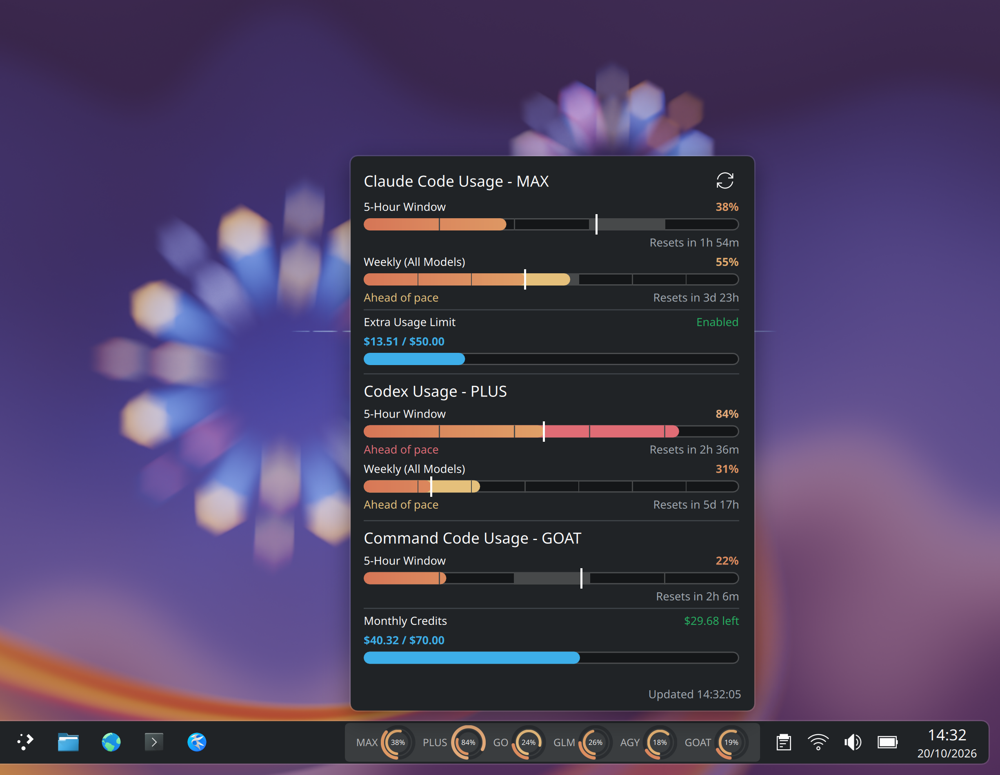
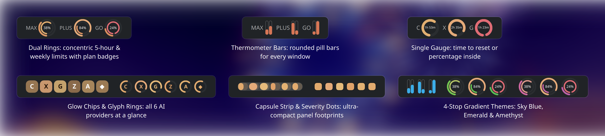
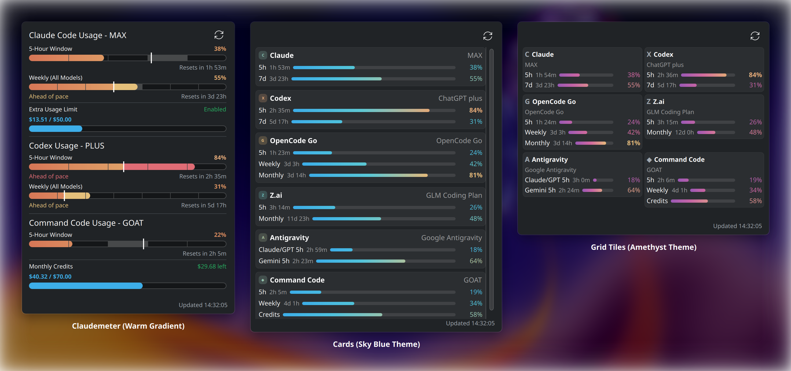

# Usage Limits (`plasma-applet-usagelimits`)

[](https://kde.org/plasma-desktop/)
[](LICENSE)
[](#supported-providers)
[](https://store.kde.org/p/2348058/)

Six AI coding assistants. One Plasma 6 panel. Live rate limits, credit pools, and pace tracking without a daemon.



## At a glance

| | |
|---|---|
| **Providers** | Claude Code, Codex, OpenCode Go, Z.ai, Antigravity, Command Code |
| **What it reads** | Each CLI's own sign-in file — no extra daemon, no third-party service |
| **Panel** | Dual rings, thermometer bars, single gauge, glow chips, glyph rings, capsule strip, severity dots, text, worst pill |
| **Popup** | Claudemeter pace bars, Cards, Compact, Grid Tiles layouts |
| **Themes** | 7 color presets + custom 4-stop gradients |

## What each provider shows

| Provider | Credentials | What's tracked |
|---|---|---|
| **Claude Code** | `~/.claude/.credentials.json` | 5-hour, weekly, Extra Usage, limit reset |
| **OpenAI Codex** | `~/.codex/auth.json` | 5-hour, 7-day, automatic token refresh |
| **OpenCode Go** | `~/.local/share/opencode/auth.json` | 5-hour rolling, weekly, monthly |
| **Z.ai** | `~/.config/usagelimits/zai-api-key` or env | 5-hour, monthly, MCP quota |
| **Antigravity** | OAuth JSON or T3 `acp_token.json` | Claude/GPT 5h, Gemini 5h |
| **Command Code** | `~/.commandcode/auth.json` | 5-hour, weekly, monthly credits |

Every provider caches its last-known state locally, so a rate-limit or outage shows `cached` data instead of a blank bar.

## Panel styles

Pick from nine compact representations in **Configure Usage Limits… → Panel style**:

- **Dual Rings** — concentric 5-hour + weekly rings per provider, with plan badges (`PRO`, `MAX`, `PLUS`, `GO`, `GLM`, `AGY`, `GOAT`)
- **Thermometer Bars** — rounded vertical pills per window
- **Single Gauge** — one ring showing time-to-reset, percentage, or provider glyph
- **Glow Chips** — provider badges whose brightness tracks the tightest window
- **Glyph Rings** — circular gauges with provider letters
- **Capsule Strip** — one segmented strip, one slot per provider
- **Severity Dots** — one dot per provider, colored by usage
- **Text** — letters plus percentages in a row
- **Worst Pill** — a single pill for the highest usage overall



## Popup layouts

Switch between four expanded popups in **Configure Usage Limits… → Expanded popup**:

- **Claudemeter** — segmented pace bars with a current-time caret and *Ahead of pace* split fills
- **Cards** — one soft panel per provider with provider mark chips
- **Compact** — dense provider list, no boxes
- **Grid Tiles** — small two-column provider tiles

Each popup also shows Extra Usage / Monthly Credits bars, reset counts, and update time.



## Color themes

Choose from seven built-in palettes or set your own four-stop gradient:

- *Claudemeter Warm* — coral → amber → yellow → red
- *Sky Blue*, *Emerald*, *Amethyst*, *Sunset*, *Nord*, *Mono*
- *Custom* — your own low / medium / warning / critical colors

The default widget colors follow the chosen theme across bars, arcs, and dots.

## Installation

Requires **KDE Plasma 6** (`kpackagetool6`, `org.kde.quickcharts`) and **Python 3** (standard library only).

```sh
git clone https://github.com/crazytweeks/plasma-applet-usagelimits.git
cd plasma-applet-usagelimits
bash install.sh
```

Then right-click your panel or desktop → **Add or Manage Widgets…** → search for **Usage Limits** (`com.crazytweeks.usagelimits`).

To test in a standalone window:

```sh
plasmawindowed com.crazytweeks.usagelimits
```

### Uninstall

```sh
kpackagetool6 -t Plasma/Applet -r com.crazytweeks.usagelimits
rm -rf ~/.cache/usagelimits
```

## Configuration

Right-click the widget and select **Configure Usage Limits…**:

| Setting | Description | Default |
|---|---|---|
| Panel style | Dual Rings, Single Gauge, Thermometer Bars, Glyph Rings, Glow Chips, Capsule Strip, Severity Dots, Text, or Worst Pill | `Dual Rings` |
| Gauge center text | Percentage, Time remaining, Provider glyph, or None | `Percentage` |
| Side label | Plan badge, Provider letter, Short name, or None | `Plan badge` |
| Popup layout | Claudemeter, Cards, Compact, or Grid | `Claudemeter` |
| Pace indicator | Hourly/daily segments, caret marker, *Ahead of pace* split fill | `On` |
| Updated time | 24-hour clock, 12-hour clock, or Relative | `24-hour` |
| Theme | Claudemeter Warm, Sky Blue, Emerald, Amethyst, Sunset, Nord, Mono, or Custom | `Claudemeter Warm` |
| Smooth gradient | Interpolate across all 4 color stops | `On` |
| Low / Medium / Warning / Critical colors | 4 independent color pickers | `#D77757` / `#DF9B65` / `#E5C07B` / `#E06C75` |
| Providers | Individual toggles for all 6 | All `On` |
| Poll interval | Seconds between polls (60–3600) | `900` (15m) |

## Re-rendering screenshots

Regenerate the high-DPI showcase images in `docs/screenshots/` from the live QML components:

```sh
python3 tools/screenshots/render.py
```

## Design inspiration

Panel gauges, thermometer bars, and segmented pace bars are inspired by [p3kj/plasma-applet-claudemeter](https://github.com/p3kj/plasma-applet-claudemeter) — the one theme we borrowed is credited there.

## License

[MIT](LICENSE)
